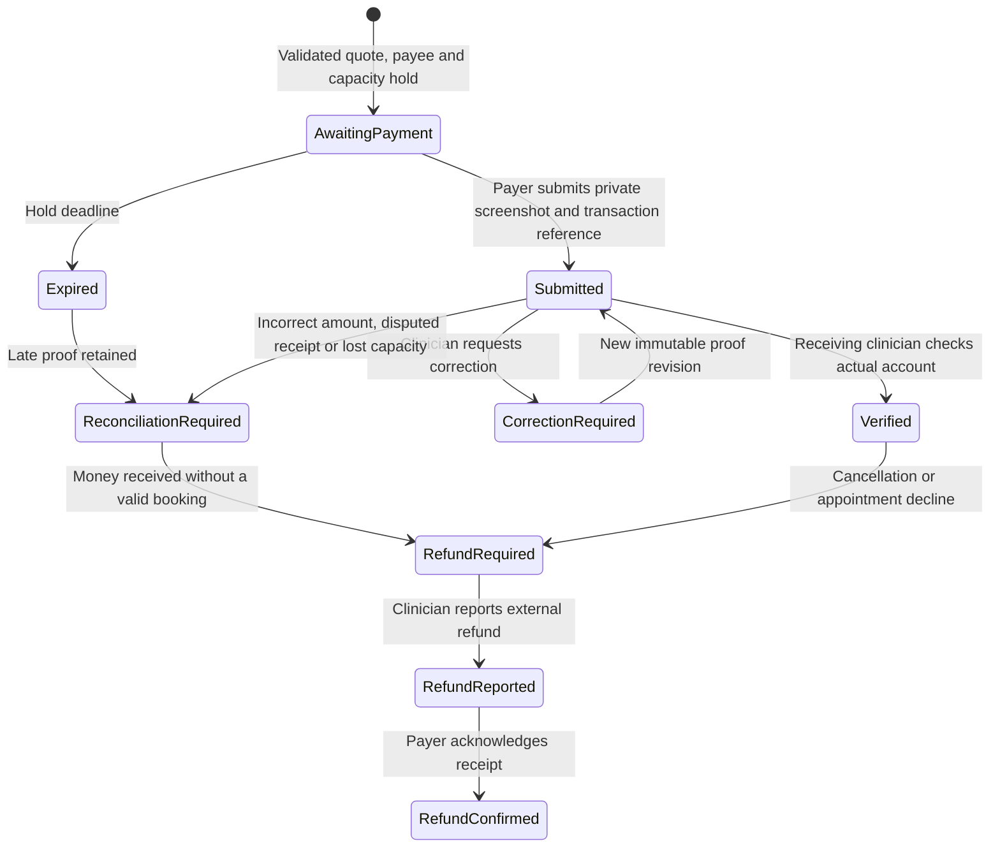

# Offline Direct Payment: Operator and Reviewer Walkthrough

This is a local review workflow, not a Telebirr integration or proof of settlement.
The global demonstration ribbon remains. Never transfer money to fixture numbers.

## Review Sites and Private Accounts

The retained preview is http://127.0.0.1:8017/teletena/ on
`teletena-mvp-presentation.localhost`. Its Wallet mode, accounts, provider settings
and balances are preserved. Existing account passwords remain in the private
site manifests (`tele_tena_presentation_accounts.json` and
`tt-demo-mvp-v2-accounts.json`), not in this repository.

The isolated Frappe16 Offline test preview is http://127.0.0.1:8021/teletena/ on
`teletena-payments-v147-fresh.localhost`. Its separate patient/clinician/reviewer/
financial-admin test accounts are in the mode600 file
`/home/frappe/teletena-offline-sprint/test-accounts.json`. Use Email → Password
sign-in for these accounts. This site has private test notification/OTP adapters
and no live Telebirr transfers or hosted LiveKit configuration. It is not a new
hosted deployment or replacement of the retained presentation dataset.

For local reboot recovery of the stable8017 preview, follow
[local-preview.md](local-preview.md). Starting the original Bench alone does not
start that isolated web/worker/scheduler arrangement.

## State Model

Payment and appointment state are separate. A valid intent creates a
Pending Confirmation appointment to protect capacity, with no reserved money.
Submitted proof extends that capacity protection only to the snapshotted
verification deadline. Automatic acceptance becomes Booked only after valid
receipt verification and current eligibility/slot checks. Manual acceptance stays
pending after verification until the clinician explicitly accepts. Its existing
confirmation timer starts at payment verification, not at the original intent.
Late or conflicting proof is retained; it does not reclaim another booking's slot.
End and finalization remain separate and do not credit an Offline payment again.

Defaults proposed for operational review: 30-minute payment hold, 24-hour
verification window, each capped at the consultation start. Configuration bounds
are 5–120 minutes and 1–72 hours. One midpoint reminder applies per intent/phase.
These are not validated optimal timings. The existing three-minute email reminder
applies only to appointment acceptance; cancellation follows its policy snapshot.

## Local Walkthrough

1. Read the Financial Configuration role restriction and mode cutover in the
   [update guide](selfmade-offline-telebirr-update.md). Reviewer accounts receive financial configuration by default under the owner-approvedv1.48 policy. Installation preserves Wallet; permission does not select a mode.
2. Clinician: Account → Professional Profile & Practice → receiving number and
   Care Languages. Save explicit language self-assessments; these are claims.
3. Reviewer: Applications → Private Documents → individual language decisions.
   General approval, service scopes, language decisions and identity-review access
   remain independent. Identification requires explicit reviewer assignment.
4. Patient: directory → profile → selected offering → sign-in/calendar → language,
   disclosure and total → payment instructions. Transfer externally only in an
   explicitly authorized real test, otherwise use the isolated synthetic fixture.
5. Submit the transaction reference and one JPEG/PNG screenshot up to 5 MB. A
   different transferred amount is retained for reconciliation, never auto-paid.
6. Clinician: notification → payment detail → check actual Telebirr account →
   Confirm Receipt, Request Correction or Reject with a reason. If acceptance is
   manual, accept the appointment separately. The UI must show both facts honestly.
7. Patient: refresh detail/Expenses Ledger; clinician: Revenue Ledger. Submitted
   totals are unverified. Verified totals reflect a human receipt decision, not
   platform custody or bank settlement. Historical Wallet Activity remains available.
8. Open Requests uses the same payable-intent path after choosing a private offer.
   Two competitors cannot see each other's offers. Couples retain independent
   consent; only the authorized payer can submit/read the receipt.
9. For cancellation, disputed confirmation, late evidence or a lost slot, retain
   the claim/history and track reconciliation/refund. Clinician reports an external
   refund; payer confirms receipt. TeleTena performs no automated transfer.
10. An Offline-parent extension requires an additional consented quote, receipt
    and verification. A Wallet-parent consultation retains its original method.

External transfers may reveal payment-account identity despite platform masking.
Do not promise payment anonymity. No platform commission is deducted automatically.
Human operational decisions remain necessary for disputed/incorrect receipts and
external refunds; the application records claims and decisions, not adjudication.

## Data and Language Review

The catalog ships 630 standardized care-language entries from the bundled
CLDR/Babel-derived source. Three interface locales are a separate concern.
Legacy declared care languages become Pending with no invented rating. Existing
appointments remain intact; authorization changes flag future care for operational
review. Previously unbooked couples invitations without a care-language snapshot
need a new invitation and both consents; booked encounters retain their history.

There are 78 competency domains (14 retained plus 64 proposed across 16 new
groups). The anchored 1–5 scale is self-assessment, not reviewer competence or
ranking. No per-domain uploader exists. Human vocabulary/scale approval is pending.

Seven proposed Ethiopian priority entries are listed with source URLs in
`tele_tena/reference_data/ethiopia-priority-v1.json`. They are curated navigation,
not measured popularity or accreditation. The Medical Lead can maintain priority
from Account. Search filters before priority ordering/pagination; selections persist.
The existing source manifest reports partial ROR coverage and MOH/WDOMS access gaps.
Combined actual counts: 8,362 issuers, 7,034 facilities, 30 professions,
32 specialties, 8 authorities. Manual/Other remains available. Institution country,
licensing jurisdiction and confirmed affiliation are never inferred from priority.

The UTF-8 translation dictionary and validation/rollback procedure are in
[the translation guide](localization-review-guide.md). Existing translations are
provisional. Human Amharic/Afaan Oromo review and approved production policy content
remain external activation requirements.
